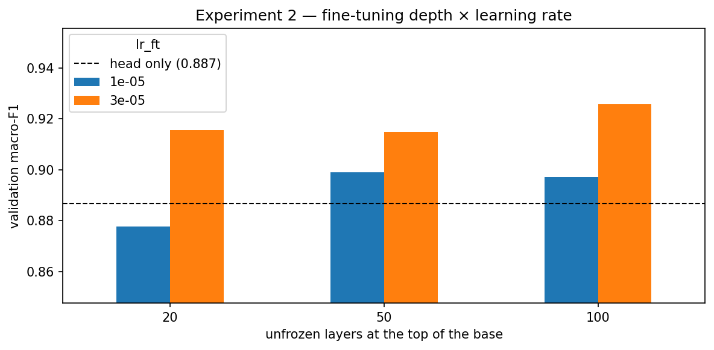
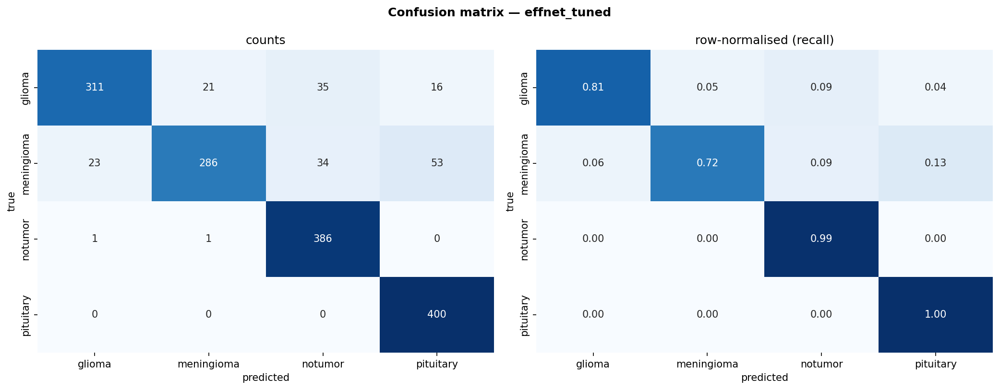
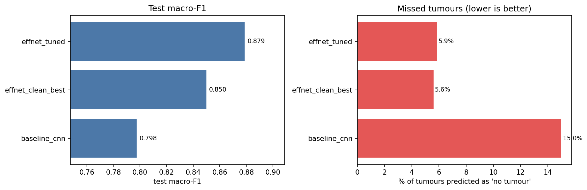
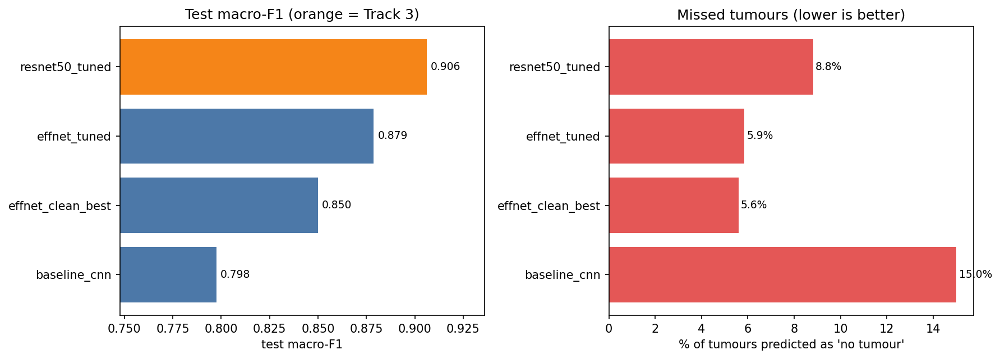
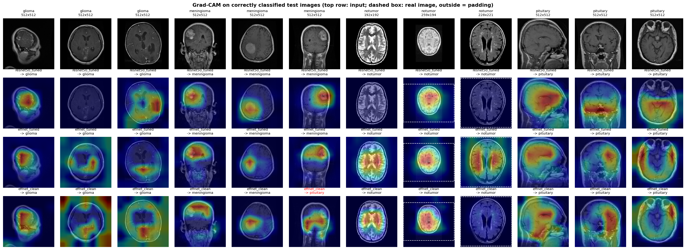
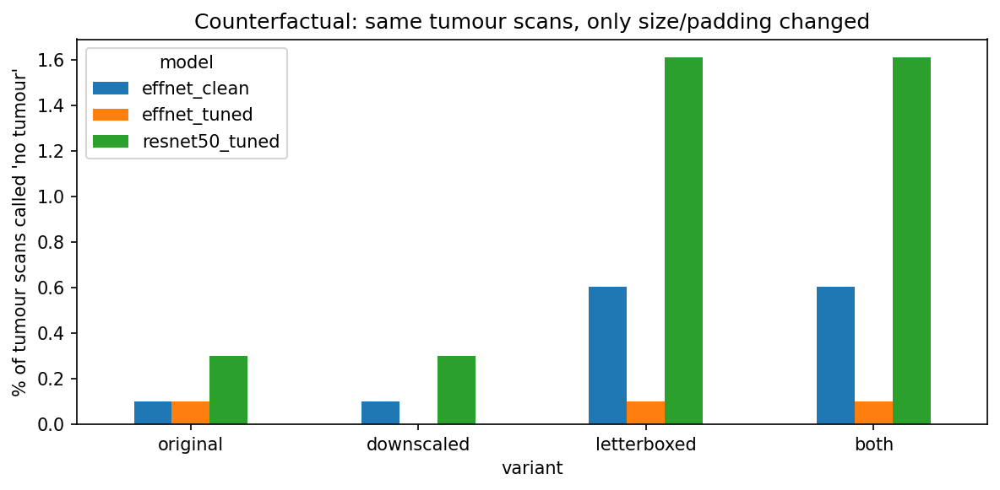
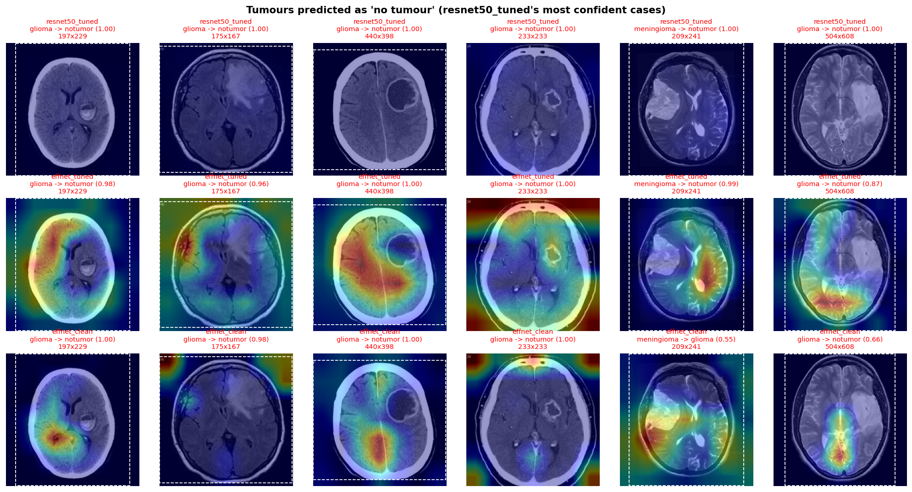

# NeuroScan — Brain Tumor MRI Classification

**Group:** Kainat Asghar (23L-0687) | Laiba Amjad (23L-0642) | Mania Ali (23L-0876)
**Course:** DataScience · FAST-NUCES, Lahore
**Current status:** Phase 1 complete (data cleaning, EDA, insights, preprocessing). Phase 2 (modelling): Tracks 1 and 2 done, Track 3 in progress; see [Phase 2 — Modelling](#phase-2--modelling) and [PHASE2.md](PHASE2.md).

---

## Description

NeuroScan is a machine-learning project that classifies brain MRI slices into four categories: **Glioma, Meningioma, Pituitary tumor** and **No tumor**. Phase 1 (this repository so far) prepares the data: it checks the dataset for corrupt files, duplicates and train/test leakage, explores it with statistics and plots, and produces a clean, uniformly preprocessed dataset ready for model training.

## Problem Statement

Given a single brain MRI image, automatically predict which of the four classes it belongs to. Before any model is trained, we need to know whether the data is clean, balanced, consistent and free of leakage. Otherwise reported accuracy would be inflated or the model would learn shortcuts (such as image size or source) instead of the tumour itself.

## Dataset

| Item | Details |
|------|---------|
| **Source** | [Brain Tumor MRI Dataset](https://www.kaggle.com/datasets/masoudnickparvar/brain-tumor-mri-dataset) (Masoud Nickparvar, Kaggle) |
| **Size** | 7,200 images: 5,600 in `Training/` and 1,600 in `Testing/` (1,800 per class) |
| **After cleaning** | 6,762 images (438 removed, 6.08%) |
| **Features** | This is an image dataset, so the raw input is the MRI image itself. In the notebook we extract per-image properties for analysis: file format, colour mode, width, height, aspect ratio, file size, intensity statistics (mean, std, min, max, skew, kurtosis, entropy, near-black pixel fraction), a texture proxy (`edge_density`), and fingerprints (`md5`, 256-bit `dhash`) |
| **Target variable** | `label`, one of 4 classes: `glioma`, `meningioma`, `notumor`, `pituitary` |

Class counts before and after cleaning:

| Class | Raw (train / test) | Clean (train / test) |
|-------|--------------------|----------------------|
| Glioma | 1400 / 400 | 1396 / 383 |
| Meningioma | 1400 / 400 | 1287 / 396 |
| No Tumor | 1400 / 400 | 1154 / 388 |
| Pituitary | 1400 / 400 | 1358 / 400 |

## Data Cleaning Summary

Nothing is deleted silently. Every removed file gets a `drop_reason` and is recorded in `data/cleaning_log.csv`.

- **Missing / corrupt data:** checked for zero-byte files, non-image extensions, unreadable images, missing labels and gaps in the extracted features. None found.
- **Blank images:** none found (pixel std < 2 rule).
- **Exact duplicates (md5):** 187 repeated files within a split were removed (first copy kept).
- **Near duplicates (dHash, confirmed by pixel comparison):** 90 repeats within a split removed, and **161 training images that also appeared in the test set were removed from training** (data leakage). The test set was left untouched.
- **Outliers (IQR rule on size, brightness, contrast, entropy, edge density):** 1,811 images (26.8%) were flagged but **kept**, because unusual MRI scans are usually valid scans from different scanners or slice levels.
- **Inconsistent formats:** 446 distinct resolutions and mixed colour modes (RGB, RGBA, L, P). All images are converted to greyscale, padded to a square, and resized to **224×224** (saved as PNG).
- **Scaling:** pixels ÷ 255, then standardised with the training-split mean (0.1749) and std (0.1953). Class weights were computed from the training split.
- **Splits:** a stratified 80/20 train/validation split of the cleaned Training data (4,156 train / 1,039 val). The cleaned Testing folder (1,567 images) is the untouched test set.

## Key Findings

1. **Leakage was real.** 161 training images were duplicates of test images, and 438 files (6.08%) were removed in total.
2. **Classes are roughly balanced** after cleaning (imbalance ratio 1.21; largest class Glioma, smallest No Tumor). We will still report macro-F1 and use mild class weights.
3. **Resolution is a shortcut risk.** Cramér's V between resolution and class is 0.52. About 96% of Glioma, Meningioma and Pituitary images are 512×512, while only 1% of No Tumor images are. No Tumor images come in many sizes (up to 630×630). A model could learn image size instead of the tumour, which is one reason we pad and resize everything to the same shape and plan to check with Grad-CAM in Phase 2.
4. **Simple features already separate classes.** The most informative are `edge_density` (MI = 0.54, ε² = 0.59), `height` and `width`. No Tumor images are brighter (mean intensity ≈ 62 vs ≈ 35 for Glioma) and have much higher edge density, which is partly a source artefact.
5. **Redundant features:** height/width (r = 0.97), skew/kurtosis (0.84) and black fraction/entropy (−0.81).
6. **Train/test shift:** width, height, contrast (std) and edge density differ noticeably between Training and Testing (KS ≈ 0.10–0.12), so test performance may differ for reasons unrelated to model quality.
7. **Pixel space is highly structured.** More than 50 principal components are needed for 90% of the variance, and the classes overlap in PCA, which suggests a deep model (CNN) is needed rather than a simple classifier on raw pixels.

All 16 figures behind these findings are in [`images/`](images/), and [`images/README.md`](images/README.md) explains, figure by figure, what each one shows and which notebook section produced it.

## Project Structure

Committed to this repository:

```
.
├── Brain_Tumor_MRI_Phase1.ipynb   ← Phase 1 notebook (cleaning, EDA, preprocessing), outputs included
├── Phase2_Track1_Kainat.ipynb     ← Phase 2 Track 1 (baseline CNN + leakage experiment)
├── Phase2_Track2_Laiba.ipynb      ← Phase 2 Track 2 (tuned EfficientNetB0: tuning grid, 2-seed final run, error analysis)
├── README.md
├── PHASE2.md                      ← Phase 2 contract: split, seed, preprocessing, track owners
├── requirements.txt               ← Python dependencies for Phase 1
├── requirements-phase2.txt        ← adds TensorFlow for Phase 2
├── .gitignore
├── dataset/                       ← raw Kaggle data (Training/, Testing/), 7,200 images
├── data/
│   ├── cleaning_log.csv           ← every removed file with its drop_reason (438 rows)
│   ├── cleaned_manifest.csv       ← the clean dataset: path, label, final split (6,762 rows)
│   ├── cleaned_metadata.csv       ← all extracted per-image features for the clean set
│   ├── preprocessing_stats.json   ← image size, scaling constants, class weights, split counts
│   └── leaked_test_images.json    ← the 155 test images duplicated in the raw training set
├── neuroscan/                     ← shared Phase 2 code, used by all three tracks
│   ├── data.py                    ← the input pipeline (clean, and the leaky one for comparison)
│   └── evaluate.py                ← one metric set for every model
├── scripts/
│   └── build_processed_data.py    ← rebuilds processed_data/ from the manifest
├── backend/                       ← web app: Flask API (app.py), inference + Grad-CAM, parity check
├── frontend/
│   └── index.html                 ← web app UI (served by the backend at /)
├── images/
│   ├── 01_*.png … 16_*.png       ← the 16 EDA figures
│   └── README.md                  ← a short note on what each figure tells us
├── models/
│   ├── effnet_clean.keras         ← the clean-data EfficientNetB0 (Track 3 runs Grad-CAM on it)
│   └── effnet_tuned.keras         ← Track 2's final tuned EfficientNetB0 (18 MB)
└── results/
    ├── comparison.{csv,md}        ← every model's scores side by side
    ├── leakage_experiment.json    ← the leakage numbers and their decomposition
    ├── *_metrics.json / *_report.txt / *_confusion.png
    ├── track2_*.csv / track2_*.png ← Track 2 tuning runs, seeds, comparison and error-analysis plots
    └── superseded/                ← the first evaluation pass, with a README explaining why
```

Created locally and excluded from the repository via `.gitignore`:

```
├── kaggle.json                    ← your own Kaggle API token (see "How to Run" below)
├── processed_data/                ← 224×224 greyscale PNGs split into train/val/test
│                                    (~6,762 images; `python scripts/build_processed_data.py`)
└── models/baseline_cnn.keras, models/effnet_leaky.keras
                                   ← 34 MB and needed by nobody else; kept on Drive
```

`data/`, `images/` and `results/` are regenerated by the notebooks; the copies here are the
outputs of the runs whose numbers are quoted throughout this README, so you can read every
result without running anything.

## How to Run the Notebook

1. **Get a Kaggle API token:** Kaggle → Settings → *Create New Token*, which downloads `kaggle.json`.
2. **Place the token:** put `kaggle.json` next to the notebook (on Colab: left sidebar → Files → upload), or save it to `~/.kaggle/kaggle.json`.
3. **Open `Brain_Tumor_MRI_Phase1.ipynb`** in Google Colab or Jupyter (Python 3.9+).
4. **Run all cells in order** (*Runtime → Run all*). The first cell installs the dependencies (the same ones listed in `requirements.txt`, which you can instead install up front with `pip install -r requirements.txt`), and the next downloads the dataset from Kaggle: [masoudnickparvar/brain-tumor-mri-dataset](https://www.kaggle.com/datasets/masoudnickparvar/brain-tumor-mri-dataset). The download is skipped if `dataset/` already exists.
5. **Check the outputs** in `data/`, `images/` and `processed_data/`. Feature extraction and preprocessing go through all 7,200 images, so expect a few minutes on a CPU.

All random operations use `SEED = 42`, so results are reproducible. No models are trained in Phase 1.

## Phase 2 — Modelling

The work is split three ways (the contract, and who owns what, is in [PHASE2.md](PHASE2.md)):

| Track | Owner | Status |
|---|---|---|
| 1 | Kainat | Shared pipeline, baseline CNN, leakage experiment — **done** |
| 2 | Laiba | EfficientNetB0 transfer learning with working fine-tuning, tuning grid, 2-seed evaluation — **done** |
| 3 | Mania | Second backbone, Grad-CAM, error analysis — in progress |

All models load through `neuroscan/data.py` and are scored by `neuroscan/evaluate.py`, so
results are comparable. Full results are in [`results/`](results/); the Track 1 notebook is
[`Phase2_Track1_Kainat.ipynb`](Phase2_Track1_Kainat.ipynb).

### Results so far

| Model | Accuracy | Macro-F1 | Tumours called "no tumour" |
|-------|----------|----------|------|
| EfficientNetB0, tuned (Track 2, seed 42) | 0.8826 | 0.8788 | 5.9% |
| EfficientNetB0 (Track 1, clean data) | 0.8551 | 0.8500 | 5.6% |
| CNN from scratch (baseline) | 0.8060 | 0.7976 | 15.0% |

The tuned model's second seed scored 0.8545 accuracy / 0.8479 macro-F1, so its two-seed mean is
0.8685 ± 0.0199 accuracy. The improvement over Track 1 is therefore **within seed-to-seed variation**
(details in [Track 2](#track-2--tuned-efficientnetb0)). The full Track 2 comparison, including AUC,
is in [`results/track2_comparison.md`](results/track2_comparison.md).

Transfer learning is worth about 5 points of accuracy here — and, more importantly, cuts the
clinically expensive error (a tumour predicted as "no tumour") from 15.0% to 5.6%. Accuracy
alone understates the difference, which is why we report macro-F1 and per-class recall.

### Phase 1 paid for itself: leakage inflates results by 3 points

The original modelling notebook trained straight off the raw `dataset/` folders, skipping all
of the Phase 1 cleaning. We trained the identical EfficientNetB0, with identical
hyperparameters, on both pipelines:

| Pipeline | Accuracy | Macro-F1 |
|----------|----------|----------|
| Clean (Phase 1 split) | 0.8551 | 0.8500 |
| Uncleaned (original notebook's) | 0.8858 | 0.8823 |
| **Inflation** | **+3.07** | **+3.23** |

The uncleaned pipeline also trained on 324 more images, so the gap alone does not prove
leakage caused it. Splitting the test set settles the question. 155 of the 1,567 test images
(9.9%) are near-duplicates of training images the uncleaned model saw — Phase 1 removed the
*training*-side copies and left the test-side twins, which is listed in
[`data/leaked_test_images.json`](data/leaked_test_images.json):

| Model | Leaked (155) | Non-leaked (1,412) |
|-------|--------------|--------------------|
| Trained on clean data | 0.5419 | 0.8895 |
| Trained on uncleaned data | **0.8258** | 0.8924 |
| Difference | **+28.39** | +0.29 |

On the images neither model memorised the two are within 0.3 points, so the extra training
data accounts for almost nothing. The whole advantage sits in the leaked slice, and the
decomposition reproduces the headline gap exactly:

```
0.099 x (+0.2839)  +  0.901 x (+0.0029)  =  +0.0307
observed gap                                +0.0307
```

Two caveats. Macro-F1 is not meaningful on the leaked subset (it contains no pituitary and
only 4 glioma), so those comparisons use accuracy. And the leakage is concentrated rather than
spread: 24.7% of the meningioma test set is compromised against 0% of pituitary. The dataset
ships augmented meningioma images (`Tr-aug-me_*`), and augmenting before splitting puts
near-copies of one scan on both sides — an argument for de-duplicating *before* the split.

### Track 2 — tuned EfficientNetB0

Notebook: [`Phase2_Track2_Laiba.ipynb`](Phase2_Track2_Laiba.ipynb) · model: [`models/effnet_tuned.keras`](models/effnet_tuned.keras)

**Method.** EfficientNetB0 (ImageNet weights) → global average pooling → dropout → Dense(256) → dropout →
Dense(4, softmax), trained through the shared pipeline (same split, seed, augmentation and metrics as
every other track). The fine-tuning bug from Track 1 is fixed in three ways: the base is called with
`training=False`, every BatchNorm layer stays frozen after unfreezing, and the head's weights are saved
and restored if fine-tuning does not improve validation macro-F1. **All choices were made on validation
macro-F1; the test set was used once, for the final report.**

**Experiment 1 — head training (backbone frozen).**

| Head learning rate | Dropout | Validation macro-F1 |
|---|---|---|
| 1e-3 | 0.3 | **0.8867** |
| 1e-3 | 0.5 | 0.8849 |
| 3e-4 | 0.3 | 0.8642 |
| 3e-4 | 0.5 | 0.8236 |

The higher learning rate wins clearly. Dropout 0.3 versus 0.5 is a tie.

**Experiment 2 — fine-tuning** (from the best head, validation macro-F1 0.8867; unfrozen layers at the top of the base × fine-tuning learning rate; BatchNorm always frozen):

| Unfrozen layers | lr 1e-5 | lr 3e-5 |
|---|---|---|
| 20 | 0.8777 | 0.9157 |
| 50 | 0.8989 | 0.9149 |
| 100 | 0.8971 | **0.9256** |



Fine-tuning works now: the best run improves on head-only training by 3.9 points, where Track 1's fine-tune
lost 16. The learning rate of 3e-5 beat 1e-5 at every depth. The three depths at 3e-5 are within about one
point of each other, which is likely a tie; the notebook picks the highest validation score (100 layers).
Each run in this grid was capped at 6 epochs, and the 1e-5 runs were still improving at the cap.

**Experiment 3 — augmentation ablation (information only).** Training the best head without augmentation gave
a *higher* validation macro-F1 (0.9602) than with it (0.8867). We did **not** adopt this: the project contract
keeps augmentation on, the validation split comes from the same folder as the training data (Phase 1 found the
test set differs from it), and the no-augmentation model was never evaluated on the test set. So validation
alone cannot say whether it would generalise better. This is an open question, not a result.

**Final model.** Configuration: head learning rate 1e-3, dropout 0.3, top 100 layers unfrozen, fine-tuning
learning rate 3e-5, batch size 32, early stopping (patience 4) with up to 8 head epochs and 8 fine-tuning epochs.
Retrained with two seeds:

| Seed | Val accuracy | Val macro-F1 | Test accuracy | Test macro-F1 | Tumours called "no tumour" |
|---|---|---|---|---|---|
| 42 (saved model) | 0.9355 | 0.9346 | 0.8826 | 0.8788 | 5.9% |
| 7 | 0.9269 | 0.9249 | 0.8545 | 0.8479 | 7.0% |
| **Mean ± std** | 0.9312 ± 0.0061 | 0.9298 ± 0.0069 | **0.8685 ± 0.0199** | **0.8634 ± 0.0218** | 6.5% ± 0.8 |

Per-class results for the saved model (test set, 1,567 images):

| Class | Precision | Recall | F1 |
|---|---|---|---|
| Glioma | 0.928 | 0.812 | 0.866 |
| Meningioma | 0.929 | 0.722 | 0.813 |
| No tumor | 0.848 | 0.995 | 0.916 |
| Pituitary | 0.853 | 1.000 | 0.921 |





**What the results mean**

- **Transfer learning with tuned fine-tuning clearly beats a CNN from scratch:** about +6 points of mean test accuracy (0.8685 vs 0.8060).
- **It is not reliably better than Track 1's EfficientNet.** Seed 42 beats Track 1's 0.8551 by 2.7 points, but seed 7 scores 0.8545, the same as Track 1. The two-seed mean is only about 1.3 points above Track 1, smaller than the 2-point spread between seeds, and two seeds are too few for a significance test. We can say the tuned model is no worse and often better, not that it is proven better.
- **Missed tumours did not improve.** 5.9% (seed 42) and 6.5% on average, against 5.6% for Track 1. Tuning raised accuracy without reducing this clinically important error.
- **Where it fails.** Meningioma is the weakest class (recall 72%): of 396 test images, 53 are called pituitary, 34 "no tumour" and 23 glioma. Glioma recall is 81% (35 called "no tumour", 21 meningioma, 16 pituitary). Pituitary recall is perfect, but precision is only 0.853 because the model over-predicts it (469 predictions against 400 true images), and "no tumour" is over-predicted too (455 against 388). The model's errors lean toward those two labels.
- **Validation is optimistic.** Mean validation macro-F1 is 0.930 against 0.863 on the test set, a gap of about 6.6 points, in line with the train/test shift Phase 1 found. The test figures are the ones to quote.

**Limitations**

- Only **two seeds** and reduced epoch caps (8 + 8) because of limited Colab compute; the tuning grid was also small (4 head settings, 6 fine-tuning settings).
- **No k-fold cross-validation.** The split is fixed by the project contract: re-splitting could put near-duplicates on both sides again, which is exactly the leakage Phase 1 removed.
- The tuning runs were capped at 6 epochs while the final model used up to 8, so the chosen setting was tested slightly more briefly than it was finally trained.
- The augmentation question (Experiment 3) is unresolved, and whether the model relies on image size instead of the tumour is not tested here (Track 3's Grad-CAM addresses that).

**Possible improvements:** more seeds or an ensemble of seeds, longer fine-tuning with a learning-rate schedule, a larger backbone, test-time augmentation, evaluating the no-augmentation variant on the test set, and removing horizontal flip.

### Known issue: fine-tuning (fixed in Track 2)

Both EfficientNet runs were initially scored on damaged weights. Unfreezing the base put every
BatchNormalization layer into training mode, which collapsed validation accuracy from 0.9355 to
0.7584 in one epoch, and `EarlyStopping(restore_best_weights=True)` resets per `fit()` call, so
it restored a phase-B epoch rather than phase A's best. Reloading the `ModelCheckpoint` recovered
16 points. Section 5 of the Track 1 notebook documents it; keep BatchNorm frozen when fine-tuning.

**Fixed in Track 2:** BatchNorm layers stay frozen, the base runs in inference mode, and fine-tuning is rolled back if it does not help validation. Fine-tuning now improves the model instead of damaging it (see [Track 2](#track-2--tuned-efficientnetb0)).


### Track 3 — ResNet50, Grad-CAM and the resolution shortcut

Notebook: [`Phase2_Track3_Mania.ipynb`](Phase2_Track3_Mania.ipynb) · model: `models/resnet50_tuned.keras` (≈100 MB, kept on Drive and not committed)

**Method.** ResNet50 (ImageNet weights) with exactly Track 2's head and BatchNorm fix, trained through the shared pipeline
(`preprocess="resnet50"`). Tuning used validation macro-F1 only: head learning rate {1e-3, 3e-4}, then unfreezing {32, 72} layers × fine-tuning
learning rate {1e-5, 3e-5}. The winner was retrained with seeds 42 and 7, as in Track 2.

**Final configuration:** [head lr, unfrozen layers, fine-tuning lr], validation macro-F1 [ ].

| Model | Test accuracy (mean ± std) | Test macro-F1 (mean ± std) | Tumours called "no tumour" |
|---|---|---|---|
| ResNet50, tuned (Track 3) | [ ] ± [ ] | [ ] ± [ ] | [ ]% |
| EfficientNetB0, tuned (Track 2) | 0.8685 ± 0.0199 | 0.8634 ± 0.0218 | 6.5% |
| Ensemble (mean of the two; seed 42 models) | [ ] | [ ] | [ ]% |

[One or two sentences: is the ResNet50 vs EfficientNet difference larger than the ~2-point seed spread? Did the ensemble help on validation *and* test?]



**Does the model look at the tumour or at the image format?** Phase 1 found resolution almost gives away the class (Cramér's V = 0.52), and
padding non-square images to a square leaves black bands. We tested this three ways.

1. *Grad-CAM, measured over all 1,567 test images.* Share of Grad-CAM attention divided by share of image area (below 1 = the model avoids the region):

   | Model | Padding (padded images) | Background (all images) |
   |---|---|---|
   | ResNet50 | [ ] | [ ] |
   | EfficientNetB0 (Track 2) | [ ] | [ ] |
   | EfficientNetB0 (Track 1) | [ ] | [ ] |

   

2. *Accuracy by original format.* Tumours called "no tumour": [ ]% of 512×512 tumour images against [ ]% of other sizes (n = 993 vs 186,
   Fisher p = [ ]) for [model]. [Interpretation. Note that format and source are confounded here.]

3. *Counterfactual.* The same 993 tumour scans, rebuilt with only their size or padding changed:

   | Variant | ResNet50: called "no tumour" | EfficientNet: called "no tumour" |
   |---|---|---|
   | original | [ ]% | [ ]% |
   | downscaled to 225×225 | [ ]% | [ ]% |
   | letterboxed (80% of frame) | [ ]% | [ ]% |
   | both | [ ]% | [ ]% |

   

**Verdict:** [no / some / strong] evidence that the models use image size or padding instead of the anatomy, because [ ].

**Error analysis.** [Main confusions for ResNet50.] Of the errors, [ ] are shared with Track 2's EfficientNet, meaning two different
architectures fail on the same images, which points at the images rather than the model. Error rates are notably higher for [property: e.g. low-contrast
images / non-512 originals / Phase 1 outliers] ([ ]% vs [ ]%). Grad-CAM on meningioma → pituitary errors shows [ ].



**Limitations.** Two seeds and a small grid; Grad-CAM at 7×7 is coarse; the format analysis is observational (the counterfactual controls for
that, but only one way: no test "no tumour" image is 512×512 except 3); no k-fold cross-validation, because the split is fixed to keep leakage out.

### Still to do
- **Final comparison across all three tracks** (`evaluate.comparison_table`) and the project conclusion.
- **Deployment** of the web app below, with the live link added here.

## Web App (Phase 3)

A Flask backend (`backend/`) serves the model and a single-page frontend (`frontend/index.html`).
Upload an MRI slice and it shows the predicted class, all four probabilities, the exact 224×224
image the model saw, and a Grad-CAM heatmap (Track 3's implementation).

```bash
pip install -r backend/requirements.txt
python backend/app.py            # then open http://localhost:5000
```

| Setting | Default | Notes |
|---|---|---|
| `MODEL_PATH` | `models/effnet_tuned.keras` | Track 2's model, the only tuned model in the repo. For Track 3's ResNet50, download `resnet50_tuned.keras` from Drive into `models/` and point this at it |
| `MODEL_PREPROCESS` | guessed from the file name | `efficientnet`, `resnet50`, `mobilenetv2` or `rescale` |
| `NOTUMOR_THRESHOLD` | from `backend/decision_rule.json` (0.9) | see below; re-run `choose_threshold.py` after changing model |
| `HOST`, `PORT` | `127.0.0.1`, `5000` | |

**The app preprocesses uploads exactly as training did** (greyscale → pad to square → 224×224 LANCZOS →
backbone preprocessing). `python backend/check_backend.py` proves it: it rebuilds every test image from
`dataset/` through the app's code, checks each against `processed_data/` pixel for pixel, and re-scores the
test set to confirm the accuracy in `results/<model>_metrics.json`.

**The app is slower to say "no tumour" than the raw model.** Track 3 found that tumour scans not sized
512×512 are often called "no tumour" (`results/track3_accuracy_by_format.csv`). The cause is the data, not
the image size itself. The training set contains no non-512 gliomas and only 23 non-512 meningiomas, while
nearly all "no tumour" scans are non-512. These scans come from a different source and are brighter, so the
model partly learned "looks like that source → no tumour". The validation split, with only 18 such tumours,
could not reveal this. The test split, with 186, does.

As a partial fix that needs no retraining, the app reports "no tumour" only when the model is at least
**90%** sure, and otherwise reports the most likely tumour class. The threshold was chosen on the
**validation set**: the strictest of 0.5–0.99 that flags at most 5% of healthy scans
(`python backend/choose_threshold.py` → `backend/decision_rule.json`). The test set was scored once, afterwards:

| Effect on the test set (EfficientNetB0, tuned) | Plain model | App (90% rule) |
|---|---|---|
| Accuracy / macro-F1 | 0.8826 / 0.8788 | 0.8890 / 0.8862 |
| Tumours called "no tumour" | 5.9% | **3.3%** |
| … of tumour scans not 512×512 | 36.6% | 21.0% |
| Healthy scans flagged as tumour | 0.5% | 2.1% |

When the rule changes an answer, the app shows **"Possible Tumour"** and gives the likely type only as a hint.
On the test set the rule changed 36 answers. 30 were tumours, but the type was right for only 16 of them.
A "No Tumour" answer for a non-512 scan is still wrong about 1 time in 11, so the app shows a warning on those
answers. The real fix needs retraining: non-512 tumour scans in the training data, and per-image intensity
normalisation to remove the brightness cue. That would change the Phase 2 contract, so it is listed as future work.
`NOTUMOR_THRESHOLD=0.5` turns the rule off.

API: `GET /health` returns the model's name and test metrics. `POST /predict` takes `multipart/form-data`
with field `file`, and `?gradcam=0` skips the heatmap.

---

⚠️ **Disclaimer:** For academic/research use only. Not a certified medical device.
